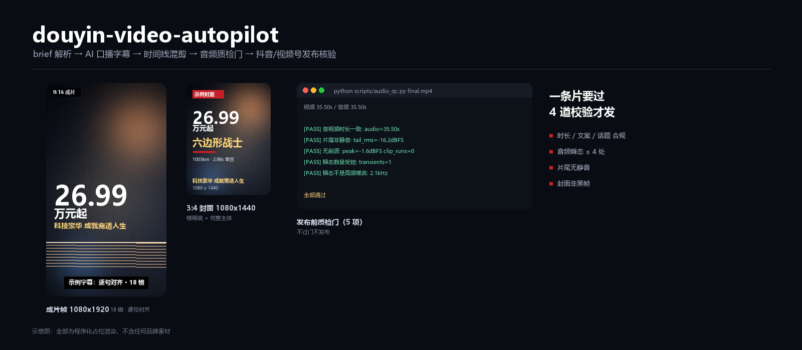

# douyin-video-autopilot

把「一份共创 brief + 一堆官方素材」变成「两条已核验的抖音/视频号链接」的开源流水线。

不是剪辑软件，也不是发布平台的官方 SDK —— 是一套**跑在本机、可审计、带质检门**的脚本 + 方法论，
把我实际做完 5 条品牌共创片（腾势 APEC / N8 预售 / 漂移学院 / N8 上市）踩过的坑固化下来。



<sub>示意图为程序化占位渲染（背景是生成的电影感底图），不含任何品牌素材；真实成片由 `build_vertical.py` + `gen_cards.py` 产出同结构画面。</sub>

## 它解决什么

- **brief 容易漏**：平台、时长、话题、植入话术、回传时间——少一条就白干，这里有一张核查表。
- **竖屏不好看**：16:9 素材硬裁会把车切掉；这里给了三种正确做法（跟主体裁切 / 海报卡 / 模糊底封面）。
- **音频容易毁片**：一次"每个切点加音效"的事故，让整片出现噗呲破音；这里的质检门会在发布前拦住。
- **发布不可回滚**：抖音没有删除/编辑接口，封面、标题、话题发错了只能人工补救；这里把核验做成必选步骤。

## 三个脚本

| 脚本 | 作用 |
|---|---|
| `scripts/tts_srt.py` | 口播稿 → `mp3` + `srt` + 句级时间轴 `json`（edge-tts） |
| `scripts/build_vertical.py` | 时间线 JSON → 1080×1920 成片（裁切/变速/调色/字卡/字幕/混音） |
| `scripts/audio_qc.py` | 发布前音频质检门：时长/静音/削波/瞬态/频谱 |
| `scripts/gen_cards.py` | 片尾卡 1080×1920 + 封面 1080×1440 |

## 快速开始

```bash
# 依赖
pip install edge-tts pillow numpy
# ffmpeg / ffprobe 需在 PATH

# 1) 配音 + 字幕
python scripts/tts_srt.py --script examples/script.example.txt --out build/vo --voice zh-CN-YunyangNeural --rate +6%

# 2) 生成封面/尾卡
python scripts/gen_cards.py examples/cards.example.json

# 3) 写时间线（照 examples/timeline.example.json 改路径和时长）
python scripts/build_vertical.py my-timeline.json --dry-run
python scripts/build_vertical.py my-timeline.json

# 4) 质检（必须全 PASS）
python scripts/audio_qc.py build/final.mp4 --expect-duration 35.5
```

## 时间线 JSON 长什么样

```jsonc
{
  "output": "build/final.mp4", "width": 1080, "height": 1920, "fps": 30, "total": 35.5,
  "grade": "eq=contrast=1.10:saturation=1.12",
  "subtitles": { "srt": "build/vo.srt", "font": "Microsoft YaHei", "size": 50, "margin_v": 250 },
  "overlays": [ { "text": "26.99万起", "size": 116, "y": 1080, "t0": 0.4, "t1": 3.3 } ],
  "shots": [
    { "src": "assets/interior.mp4", "in": 57.5, "dur": 1.5 },
    { "src": "assets/hero.mp4",     "in": 1.5,  "dur": 2.22, "pan": [0.35, 0.65] },
    { "src": "assets/poster.png",   "mode": "pad", "dur": 3.0 },
    { "src": "build/cards/endcard.png", "mode": "card", "dur": 2.1 }
  ],
  "audio": { "voice": "build/vo.mp3", "bgm": "assets/bgm.mp3", "bgm_gain": 0.12, "target_lufs": -14 }
}
```

镜头模式：`video`（默认，可变速/跟踪）、`photo`（静帧 Ken Burns）、`pad`（海报卡，不裁字）、`card`（整图铺满）。

## 质检门判定标准

| 检查 | 阈值 | 为什么 |
|---|---|---|
| 音视频等长 | ±0.30s | `amix duration=first` 会让片尾静音 |
| 片尾 RMS | > -60 dBFS | 黑屏静音会被判低质 |
| 峰值 / 削波 | ≤ -1.0 dBFS，无连续削波 | 防爆音 |
| 周期性瞬态 | ≤ 4 处 | 每个切点一条音效的典型症状 |
| 瞬态频谱重心 | < 6 kHz | 高频噪声型 whoosh = "噗呲" |

## 文档

- [docs/workflow.md](docs/workflow.md) — 从 brief 到回传的 9 步 + 时间预算
- [docs/pitfalls.md](docs/pitfalls.md) — 15 条真实事故：现象 / 根因 / 正确做法
- [docs/publishing.md](docs/publishing.md) — 抖音 CDP 与视频号 `sau` 的完整命令、能力边界、cookie 寿命
- [docs/brief-checklist.md](docs/brief-checklist.md) — 共创 brief 硬指标核查表
- [SKILL.md](SKILL.md) — 给 AI agent 用的技能文件

## 目录结构

```
scripts/   四个可执行脚本（无个人路径、参数化）
docs/      方法论与踩坑
examples/  时间线 / 卡片 / 口播稿 / brief 拆解样例
SKILL.md   技能入口（agent 读）
```

## 边界与免责

- 发布依赖**你本人账号的登录态**（抖音 Chrome profile、视频号 cookie），仓库不含任何凭据，也不会自动登录。
- 平台前端随时可能改版，选择器失效属正常损耗；`docs/publishing.md` 记录了当前可用的路径与元素特征。
- 仅供内容创作与运营提效；**素材版权、品牌授权、平台规则由使用者自行负责**。仓库不附带任何品牌素材。
- 自动化操作有账号风险，请遵守各平台用户协议，控制频率。

## License

MIT
